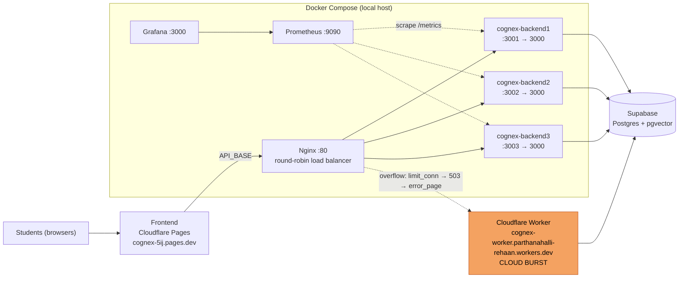

# Cognex DA3 — Question 1: Scale your application (5 marks)

Deadline for the whole assignment: **30/10/2026**. Q1 target window from your plan: **Oct 20–23**.

| Part | Marks | Branch | What you must show |
|---|---|---|---|
| Setup | – | `feat/node-server` | Your Hono app running in Docker (Worker untouched) |
| (a) | 1 | `feat/nginx-lb` | Peak-demand paragraph, 3 backends behind Nginx, requests hitting all 3 |
| Observability | – | `feat/observability` | `/metrics`, JSON logs, Prometheus + Grafana |
| (b) | 1.5 | `perf/load-tests` | 1,000 requests, 1 vs 3 instances, table + improvement % |
| (c) | 1.5 | `fix/nginx-failover` | Stop an instance mid-test, failed count before vs after |
| (d) | 1 | `docs/q1-architecture` | Diagram with real names/ports + cloud bursting in a different colour |

Commands are bash (Git Bash, WSL, macOS, Linux). On PowerShell, use `curl.exe` instead of `curl`, and set env vars with `$env:NAME="value"`.

---

## 0. What I found in your repo (read this first)

Checked against commit `21df4a2` of `3_Cognex`.

1. `backend/cognex-worker/src/index.js` default-exports a Hono app and reads every secret from `c.env`. So `app.fetch(req, process.env)` in Node works, and **`src/index.js` stays untouched** (the Cloudflare deployment is unaffected).
2. `GET /api/graph?repoUrl=...` lazy-loads only `supabase.js`. It never touches Groq, Cohere or GitHub, so it has no third-party rate limits. That makes it a good load-test target.
3. `POST /api/ingest` passes `c.executionCtx` to `rag.ingestRepo`. Node has no `ExecutionContext`, so accessing it throws. `server.js` below passes a small stub so `waitUntil` still works.
4. `/api/status` keeps ingestion progress in memory, so three instances can disagree. Exclude it from tests and mention it in the report.
5. There is a **stray file named `-H` tracked in git** at the repo root. It holds an "Invalid API Key" error from a bad `curl` command. Remove it in your first commit.
6. `.env` is already ignored by your `.env*` rule. It must **also** be in `.dockerignore`, or `COPY . .` bakes your keys into the image layers.
7. Your frontend calls the Worker (`API_BASE` in `frontend/app.js`, lines 3–8). The Nginx stack is a second, scaled deployment. In the diagram, show the frontend's `API_BASE` pointing at Nginx, and say in one sentence that the Worker is the original deployment and the burst target.

---

## 1. Git setup

```bash
cd 3_Cognex
git switch main && git pull
git switch -c assignment-3
git push -u origin assignment-3
```

Every piece below follows the same loop:

```bash
git switch assignment-3 && git pull
git switch -c <branch-name>
# work + conventional commits (feat:, fix:, perf:, docs:, chore:)
git push -u origin <branch-name>
# GitHub: open PR, base = assignment-3, "Create a merge commit" (this is --no-ff)
```

New folders at the repo root, created across the steps:

```
docker-compose.yml
nginx/            nginx.3.conf, nginx.1.conf
prometheus/       prometheus.yml
grafana/provisioning/datasources/prometheus.yml
perf/             run-hey.sh, results/
docs/evidence/q1/ screenshots + raw hey outputs
backend/cognex-worker/   server.js, Dockerfile, .dockerignore, .env.example
```

---

## 2. Setup: run your Hono app in Node (`feat/node-server`)

### 2.1 First commit: remove the stray file

```bash
git switch -c feat/node-server
git rm -- -H
git commit -m "chore: remove stray curl output file"
```

### 2.2 Install the adapter

```bash
cd backend/cognex-worker
npm install @hono/node-server prom-client pino
```

(`prom-client` and `pino` are used in section 4. Installing now means `package-lock.json` changes once.)

Add one script to `package.json` and leave `start` and `deploy` as they are:

```json
"start:node": "node --env-file=.env server.js"
```

### 2.3 `backend/cognex-worker/server.js`

```js
import { serve } from '@hono/node-server';
import app from './src/index.js';

const INSTANCE_ID = process.env.INSTANCE_ID || 'local';
const PORT = Number(process.env.PORT) || 3000;

// Workers hand the app an ExecutionContext; Node doesn't.
// This stub keeps c.executionCtx.waitUntil() (used by /api/ingest) working.
const executionCtx = {
  waitUntil: (p) => { Promise.resolve(p).catch((e) => console.error('waitUntil error', e)); },
  passThroughOnException: () => {},
};

async function handle(req) {
  const res = await app.fetch(req, process.env, executionCtx);
  const out = new Response(res.body, res);
  out.headers.set('X-Instance-ID', INSTANCE_ID);
  return out;
}

serve({ fetch: handle, port: PORT }, (info) =>
  console.log(`cognex instance ${INSTANCE_ID} listening on :${info.port}`));
```

Smoke test outside Docker (use a repo that is **already ingested** in your Supabase):

```bash
INSTANCE_ID=local npm run start:node
# second terminal:
curl -i http://localhost:3000/health          # 200 + X-Instance-ID: local
curl -s "http://localhost:3000/api/graph?repoUrl=https://github.com/OWNER/REPO" | head -c 300
```

### 2.4 Dockerfile, `.dockerignore`, `.env.example`

Keep this Dockerfile **deliberately plain**. It becomes your `q2c-before` baseline for Trivy in Q2(c), so don't optimise it now.

`backend/cognex-worker/Dockerfile`

```dockerfile
FROM node:20
WORKDIR /app
COPY package*.json ./
RUN npm ci
COPY . .
EXPOSE 3000
CMD ["node", "server.js"]
```

`backend/cognex-worker/.dockerignore`

```
node_modules
.env*
.wrangler
.git
.vscode
test
```

`backend/cognex-worker/.env.example`: copy the **key names** from your real `.env` and leave every value blank. For `/api/graph`, the containers need at least `SUPABASE_URL` and `SUPABASE_SERVICE_KEY`.

```bash
git add server.js package.json package-lock.json Dockerfile .dockerignore .env.example
git commit -m "feat(server): run Hono app on @hono/node-server with X-Instance-ID header"
```

Open the PR into `assignment-3` and merge.

---

## 3. Q1(a): peak demand + 3 instances behind Nginx (`feat/nginx-lb`)

### 3.1 Peak-demand paragraph (rewrite in your own words)

> **Situation:** Cognex is used by students to explore a GitHub repository as a knowledge graph. Near a class assignment deadline, hundreds of students open the same course repository's graph within a few minutes (a short, spiky rush).
> **Hardest-hit API:** `GET /api/graph?repoUrl=...`. The frontend calls it on every page load and again on refresh (`app.js`). Each call runs two parallel Supabase reads (nodes and edges). It is read-heavy and identical across users. `/api/ask` is limited by Groq quotas and `/api/ingest` is a one-off per repo, so the graph endpoint is what scales with the number of students.

### 3.2 `docker-compose.yml` (repo root)

```yaml
name: cognex

x-backend: &backend
  build: ./backend/cognex-worker
  image: cognex-backend:local
  env_file: ./backend/cognex-worker/.env
  init: true                    # tini as PID 1, so `docker stop` is instant
  restart: unless-stopped
  healthcheck:
    test: ["CMD", "node", "-e", "fetch('http://localhost:3000/health').then(r=>process.exit(r.ok?0:1)).catch(()=>process.exit(1))"]
    interval: 10s
    timeout: 3s
    retries: 3
    start_period: 10s

services:
  backend1:
    <<: *backend
    container_name: cognex-backend1
    environment: { INSTANCE_ID: "1" }
    ports: ["3001:3000"]
  backend2:
    <<: *backend
    container_name: cognex-backend2
    environment: { INSTANCE_ID: "2" }
    ports: ["3002:3000"]
  backend3:
    <<: *backend
    container_name: cognex-backend3
    environment: { INSTANCE_ID: "3" }
    ports: ["3003:3000"]

  nginx:
    image: nginx:1.27-alpine
    container_name: cognex-nginx
    ports: ["80:80"]
    volumes:
      - ./nginx/${NGINX_CONF:-nginx.3.conf}:/etc/nginx/nginx.conf:ro
    depends_on:
      backend1: { condition: service_healthy }
      backend2: { condition: service_healthy }
      backend3: { condition: service_healthy }
```

If port 80 is busy on your machine, use `"8080:80"` and put `:8080` in every URL below. The diagram still labels Nginx as `:80` inside the stack.

### 3.3 `nginx/nginx.3.conf`

```nginx
worker_processes auto;
events { worker_connections 1024; }

http {
    log_format lb '$remote_addr [$time_local] "$request" $status '
                  'upstream=$upstream_addr rt=$request_time urt=$upstream_response_time';
    access_log /var/log/nginx/access.log lb;   # the nginx image sends this to stdout

    upstream cognex_backends {
        server backend1:3000;
        server backend2:3000;
        server backend3:3000;
    }

    server {
        listen 80;

        # Prometheus scrapes the backends directly, not through the load balancer
        location = /metrics { return 404; }

        location / {
            proxy_pass http://cognex_backends;
            proxy_set_header Host $host;
            proxy_set_header X-Real-IP $remote_addr;
            proxy_set_header X-Forwarded-For $proxy_add_x_forwarded_for;
        }
    }
}
```

Now make the 1-instance variant (used in (b)): copy it to `nginx/nginx.1.conf` and delete the `backend2` and `backend3` lines.

### 3.4 Run it

```bash
docker compose up -d --build        # first build is slow (@xenova/transformers is big); later builds are cached
docker ps                           # wait for all 3 backends to show (healthy)
```

### 3.5 Evidence for (a)

Set your repo URL once:

```bash
URL="http://localhost/api/graph?repoUrl=https://github.com/OWNER/REPO"
```

1. **`docker ps`**: names `cognex-backend1..3`, `cognex-nginx`, and ports 3001–3003 and 80.
2. **Rotation**: 30 requests, counted per instance (expect about 10 each):

   ```bash
   for i in $(seq 1 30); do curl -s -o /dev/null -D - "$URL" | grep -i '^x-instance-id'; done | sort | uniq -c
   ```

   PowerShell:

   ```powershell
   1..30 | % { (curl.exe -s -o NUL -D - $URL | Select-String "x-instance-id").Line } | Group-Object | Select Count,Name
   ```

3. **Nginx log** showing three different `upstream=` addresses:

   ```bash
   docker logs cognex-nginx --tail 20
   docker inspect -f '{{.Name}} {{range .NetworkSettings.Networks}}{{.IPAddress}}{{end}}' cognex-backend1 cognex-backend2 cognex-backend3
   ```

   The second command maps each IP to a container name. Include it in the screenshot as a legend.

Save the screenshots as `docs/evidence/q1/a-docker-ps.png`, `a-curl-rotation.png`, `a-nginx-log.png`.

```bash
git add docker-compose.yml nginx/
git commit -m "feat(lb): three backends behind nginx round-robin with upstream logging"
```

> **Screenshot hygiene:** don't screenshot `docker inspect` (full output), `docker compose config`, or your `.env`. They print secret values.

---

## 4. Observability (`feat/observability`)

### 4.1 Replace `server.js` with the instrumented version

```js
import { serve } from '@hono/node-server';
import client from 'prom-client';
import pino from 'pino';
import app from './src/index.js';

const INSTANCE_ID = process.env.INSTANCE_ID || 'local';
const PORT = Number(process.env.PORT) || 3000;
const log = pino({ base: { instance_id: INSTANCE_ID } });

client.collectDefaultMetrics();
const httpDuration = new client.Histogram({
  name: 'http_request_duration_seconds',
  help: 'HTTP request duration in seconds',
  labelNames: ['method', 'route', 'status'],
  buckets: [0.01, 0.025, 0.05, 0.1, 0.25, 0.5, 1, 2.5, 5, 10],
});

const UUID = /[0-9a-f]{8}-[0-9a-f]{4}-[0-9a-f]{4}-[0-9a-f]{4}-[0-9a-f]{12}/gi;

const executionCtx = {
  waitUntil: (p) => { Promise.resolve(p).catch((e) => log.error({ err: String(e) }, 'waitUntil error')); },
  passThroughOnException: () => {},
};

async function handle(req) {
  const { pathname } = new URL(req.url);

  if (pathname === '/metrics') {
    return new Response(await client.register.metrics(), {
      headers: { 'Content-Type': client.register.contentType },
    });
  }

  const start = process.hrtime.bigint();
  const res = await app.fetch(req, process.env, executionCtx);
  const out = new Response(res.body, res);
  out.headers.set('X-Instance-ID', INSTANCE_ID);

  const seconds = Number(process.hrtime.bigint() - start) / 1e9;
  httpDuration.observe(
    { method: req.method, route: pathname.replace(UUID, ':id'), status: String(out.status) },
    seconds,
  );
  if (pathname !== '/health') {
    log.info({ method: req.method, path: pathname, status: out.status, ms: Math.round(seconds * 1000) });
  }
  return out;
}

serve({ fetch: handle, port: PORT }, (info) => log.info({ port: info.port }, 'listening'));
```

### 4.2 Prometheus and Grafana

`prometheus/prometheus.yml`

```yaml
global:
  scrape_interval: 5s
scrape_configs:
  - job_name: cognex-backends
    static_configs:
      - targets: ['backend1:3000', 'backend2:3000', 'backend3:3000']
```

`grafana/provisioning/datasources/prometheus.yml`

```yaml
apiVersion: 1
datasources:
  - name: Prometheus
    type: prometheus
    access: proxy
    url: http://prometheus:9090
    isDefault: true
```

Add to `docker-compose.yml` under `services:`

```yaml
  prometheus:
    image: prom/prometheus
    container_name: cognex-prometheus
    volumes: ["./prometheus/prometheus.yml:/etc/prometheus/prometheus.yml:ro"]
    ports: ["9090:9090"]

  grafana:
    image: grafana/grafana
    container_name: cognex-grafana
    ports: ["3000:3000"]
    volumes: ["./grafana/provisioning:/etc/grafana/provisioning:ro"]
    depends_on: [prometheus]
```

```bash
docker compose up -d --build
curl -s http://localhost:3001/metrics | head       # metrics straight from backend1
```

Open `http://localhost:9090/targets` (all 3 should be UP), then Grafana at `http://localhost:3000` (login `admin` / `admin`). Build one dashboard with 3 panels:

| Panel | PromQL |
|---|---|
| Requests/sec per instance | `sum by (instance) (rate(http_request_duration_seconds_count{route="/api/graph"}[30s]))` |
| p95 latency | `histogram_quantile(0.95, sum by (le) (rate(http_request_duration_seconds_bucket{route="/api/graph"}[30s])))` |
| Errors (5xx) per instance | `sum by (instance) (rate(http_request_duration_seconds_count{status=~"5.."}[30s]))` |

Note for the report: 502s generated **by Nginx** when a backend is dead never reach the backends, so they don't appear in these panels. For part (c), the failed count comes from `hey` and the Nginx log.

```bash
git add server.js package.json package-lock.json docker-compose.yml prometheus grafana
git commit -m "feat(observability): prom-client metrics, pino JSON logs, Prometheus and Grafana"
```

---

## 5. Q1(b): load test, 1 vs 3 instances (`perf/load-tests`)

### 5.1 Install `hey`

Download the binary for your OS from the `rakyll/hey` GitHub README, or `brew install hey`, or `go install github.com/rakyll/hey@latest`.
Fallback with Apache Bench, which also gives you a 95% row:

```bash
docker run --rm --network cognex_default httpd:2.4 ab -n 1000 -c 50 "http://nginx/api/graph?repoUrl=https://github.com/OWNER/REPO"
```

### 5.2 Pick the right repo

Choose an ingested repo where one `/api/graph` call takes roughly 100–300 ms:

```bash
curl -s -o /dev/null -w "%{size_download} bytes, %{time_total}s\n" "$URL"
```

If it takes about 10 ms, Nginx and your laptop are the bottleneck and 3 instances won't show. If it takes several seconds, Supabase is the bottleneck. Pick one repo and keep it for every run.

### 5.3 `perf/run-hey.sh`

```bash
#!/usr/bin/env bash
# usage: perf/run-hey.sh <label> <url>
set -euo pipefail
LABEL=$1; URL=$2
mkdir -p perf/results
hey -n 100 -c 10 "$URL" > /dev/null                     # warm-up, not recorded
for i in 1 2 3; do
  hey -n 1000 -c 50 "$URL" > "perf/results/${LABEL}_run${i}.txt"
done
for f in perf/results/${LABEL}_run*.txt; do
  echo "== $f"
  grep -E "Requests/sec|Average:|95% in|\[[0-9]+\]" "$f"
done
```

### 5.4 Run both configurations (same command, same concurrency)

```bash
chmod +x perf/run-hey.sh

# 1 instance: nginx routes only to backend1
NGINX_CONF=nginx.1.conf docker compose up -d nginx
perf/run-hey.sh one "$URL"

# 3 instances
NGINX_CONF=nginx.3.conf docker compose up -d nginx
perf/run-hey.sh three "$URL"
```

PowerShell: set `$env:NGINX_CONF="nginx.1.conf"` on its own line first. The other two backends keep running idle during the 1-instance test. That is fine, since only one receives traffic.

Test hygiene:
- Plug the laptop in and close heavy apps.
- Keep Prometheus and Grafana running for both configs so conditions match.
- Don't touch `/api/ask`.

### 5.5 Result table (take the **median** run by requests/sec)

| Metric | 1 instance | 3 instances | Change |
|---|---|---|---|
| Requests/sec | | | +__ % |
| Average latency (ms) | | | −__ % |
| p95 latency (ms) | | | −__ % |
| Failed requests (non-200) | | | |

Formulas: `improvement % = (rps₃ − rps₁) / rps₁ × 100`, and `latency reduction % = (avg₁ − avg₃) / avg₁ × 100`.

Expect about 1.5–2.5×, not 3×. Say why in the report: all three containers, Nginx, Prometheus, Grafana and `hey` share one laptop's CPU, and all three backends hit the same Supabase project, which is the shared bottleneck.

Evidence: `docs/evidence/q1/b-hey-1-instance.txt`, `b-hey-3-instances.txt` (the median runs), and a Grafana screenshot during the 3-instance run (`b-grafana.png`) showing three lines in the requests/sec panel.

```bash
git add perf docs
git commit -m "perf: load test /api/graph with 1 vs 3 instances"
```

---

## 6. Q1(c): failover (`fix/nginx-failover`)

### 6.1 A catch about Nginx's defaults

Nginx's built-in default is `proxy_next_upstream error timeout`. That means **a plain Nginx may already retry connection errors on idempotent requests**, and `max_fails=1 fail_timeout=10s` are defaults too. So the plain config from (a) might show zero, or only a few, failures. Don't assume. Test it:

1. **Run A: plain config from (a).** Record whatever you get. If it is already 0, that is a real finding. Report it honestly.
2. **Run B: explicit no-retry baseline.** This is the "before" for the assignment: a load balancer with retries disabled, which is a common misconfiguration. Describe it in the report as exactly that, not as "the default".

### 6.2 Before: no-retry baseline

In `nginx/nginx.3.conf`, add to `location /` (leave everything else as is):

```nginx
            proxy_next_upstream off;
```

```bash
git switch -c fix/nginx-failover
git add nginx && git commit -m "test(nginx): explicit no-retry baseline for failover test"
git tag q1c-before
```

### 6.3 Run the "before" test

Size `-n` so the run lasts about 20 s: `n ≈ rps₃ × 20`. Below, `-n 3000` is an example.

```bash
NGINX_CONF=nginx.3.conf docker compose up -d nginx
docker compose restart nginx

(sleep 5; docker stop cognex-backend2) &
hey -n 3000 -c 50 "$URL" | tee perf/results/failover_before.txt
```

PowerShell: start a job first with `Start-Job { Start-Sleep 5; docker stop cognex-backend2 }`, then run `hey` in the same window.

Count failures: `failed = total − [200]` from "Status code distribution", plus anything under "Error distribution".

```bash
grep -A6 -E "Status code distribution|Error distribution" perf/results/failover_before.txt
```

With retries off, Nginx never marks backend2 as down. About a third of all requests after the stop should come back as `[502]`.

Bring it back and reset between runs:

```bash
docker start cognex-backend2
docker ps                      # wait for (healthy)
docker compose restart nginx   # re-resolves container IPs
sleep 12
```

### 6.4 After: the fix

Edit `nginx/nginx.3.conf`: replace the `upstream` block and the `location /` block.

```nginx
    upstream cognex_backends {
        server backend1:3000 max_fails=1 fail_timeout=10s;
        server backend2:3000 max_fails=1 fail_timeout=10s;
        server backend3:3000 max_fails=1 fail_timeout=10s;
    }

    server {
        listen 80;
        location = /metrics { return 404; }

        location / {
            proxy_pass http://cognex_backends;
            proxy_set_header Host $host;
            proxy_set_header X-Real-IP $remote_addr;
            proxy_set_header X-Forwarded-For $proxy_add_x_forwarded_for;

            proxy_connect_timeout 1s;
            proxy_next_upstream error timeout http_502 http_503;
            proxy_next_upstream_tries 3;
            proxy_next_upstream_timeout 5s;
        }
    }
```

What each line does (use this in the report):
- `max_fails=1 fail_timeout=10s`: one failure takes the server out of rotation for 10 s.
- `proxy_connect_timeout 1s`: a dead backend is detected in 1 s, not the 60 s default.
- `proxy_next_upstream ...`: a failed attempt is retried on the next backend, so the client never sees the error.
- Do **not** add `non_idempotent`. Nginx retries idempotent methods (GET, HEAD, PUT, DELETE). It must not replay a `POST /api/ingest` or `/api/ask` that was already sent.

```bash
git add nginx && git commit -m "fix(nginx): retry failed upstreams and mark dead backends down"
git tag q1c-after

docker compose restart nginx
(sleep 5; docker stop cognex-backend2) &
hey -n 3000 -c 50 "$URL" | tee perf/results/failover_after.txt
docker start cognex-backend2
```

Expect 0 failed. If you see 1–2, those were requests already mid-response when the container died. Nginx can't retry after it has started sending a response. Re-run to confirm, and mention it in the report if it persists.

### 6.5 Result table

| Config | Total requests | 200 OK | Failed | Failed % |
|---|---|---|---|---|
| Plain default (Run A, optional) | 3000 | | | |
| Before: retries off (`q1c-before`) | 3000 | | | |
| After: retry + fast failover (`q1c-after`) | 3000 | | | 0 % |

Evidence: `c-before.txt`, `c-after.txt`, plus a screenshot of `docker ps` showing backend2 stopped. Push the tags with `git push origin q1c-before q1c-after`.

---

## 7. Q1(d): architecture diagram (`docs/q1-architecture`)

Start from this Mermaid source (GitHub renders it in a `.md` file). Export a PNG from <https://mermaid.live>, or redraw it in draw.io. The **cloud-bursting** node and its link must be a different colour. Use your real Pages and Worker hostnames.



### Explanation paragraph (adapt it)

> **How bursting handles the deadline rush:** the three Docker backends are sized for normal day-to-day load. When a deadline pushes concurrent connections past what local capacity can serve, Nginx sends the overflow to the already-deployed Cloudflare Worker, which runs the same Hono code against the same Supabase database. Students never see an error page, and the burst capacity is only used (and only billed) while the spike lasts.
> **Why it fits this domain:** the load is short, predictable and read-only (`GET /api/graph`), so sizing local hardware for the peak would leave it idle the rest of the term. The Worker already exists from Assignment 1, so it needs no new infrastructure. The API is stateless, so any instance can answer any request.
> **Limit:** both paths share Supabase, so bursting adds compute capacity but doesn't remove the database bottleneck.

### Bonus: implement the burst (about 20 min, only after (a)–(c) are done)

In `nginx.3.conf`, inside `http {}`:

```nginx
    limit_conn_zone $server_name zone=local_capacity:1m;
```

In `location /` add:

```nginx
            limit_conn local_capacity 20;     # demo value: the "local capacity" before overflow
            limit_conn_status 503;
            error_page 503 = @burst;
```

Next to `location /`:

```nginx
        location @burst {
            proxy_pass https://cognex-worker.parthanahalli-rehaan.workers.dev;
            proxy_ssl_server_name on;
            proxy_set_header Host cognex-worker.parthanahalli-rehaan.workers.dev;
            add_header X-Burst "cloudflare-worker" always;
        }
```

Run `hey -n 1000 -c 60` and check `docker logs cognex-nginx`. Overflow requests show an `upstream=` address on port 443 instead of `172.x.x.x:3000`. Do this in a separate commit so you can drop it if it misbehaves.

---

## 8. Report and demo checklist for Q1

**Report (per part: explanation, screenshot, table):**
- (a) Peak paragraph, `docker ps`, rotation count, Nginx log with IP legend.
- (b) Table with improvement %, Grafana screenshot, one line on why it's below 3×.
- (c) Before/after table, the two Nginx configs, tags `q1c-before` / `q1c-after`, the note on Nginx's defaults (6.1).
- (d) Diagram, explanation paragraph.

**Known limits to state:**
- `/api/status` is in-memory, so it can answer inconsistently across 3 instances (excluded from tests).
- Speedup is capped by one shared laptop and Supabase latency.
- Bursting is described in the diagram, and implemented only if you did the bonus.
- The frontend still calls the Worker by default. The Nginx stack was exercised with `curl` and `hey`.

**Q1 share of the 3-minute demo (about 95 s):**
1. `docker compose up`, then the curl rotation count (30 s).
2. `hey` with 1 vs 3 instances, then the Grafana dashboard (40 s).
3. Stop an instance mid-test, before vs after (25 s).

Record the diagram part together with the Q2 agent clip at the end.

---

## 9. Troubleshooting

| Symptom | Fix |
|---|---|
| `port is already allocated` on 80 | Change to `"8080:80"`, and use `:8080` in URLs |
| `npm ci` killed or very slow in the build | Give Docker Desktop at least 4 GB RAM. `@xenova/transformers` is heavy |
| Compose error parsing `.env` | Open the named line and remove stray quotes, `export`, or spaces around `=` |
| Backend `(unhealthy)` | `docker logs cognex-backend1`. Usually missing `SUPABASE_URL` or `SUPABASE_SERVICE_KEY` |
| `/api/graph` returns 500 | `docker exec cognex-backend1 printenv SUPABASE_URL` (check it exists, don't screenshot the key) |
| Nginx 502 right after restarting a stopped backend | `docker compose restart nginx` so it re-resolves container IPs |
| `hey` shows lots of Supabase 5xx | Re-run later, and record the numbers as they are. Keep `-c 50` for both configs |
| Docker build can't resolve packages | Check your internet connection, then rebuild with `docker compose build --no-cache` |

---

## 10. Q1 done when

- [ ] `git rm -- -H` committed; `assignment-3` exists and every piece was merged by PR with `--no-ff`
- [ ] `docker ps` shows 3 backends + nginx (+ prometheus, grafana), all healthy
- [ ] Rotation count shows all three `X-Instance-ID` values
- [ ] `perf/results/` holds 3 runs each for `one` and `three`; table filled with improvement %
- [ ] Failover before/after outputs saved; tags `q1c-before` and `q1c-after` pushed
- [ ] Diagram exported with the cloud-bursting node in a different colour, plus explanation
- [ ] No `.env` content in any screenshot or commit (`git log -p | grep -i "service_key"` finds nothing)