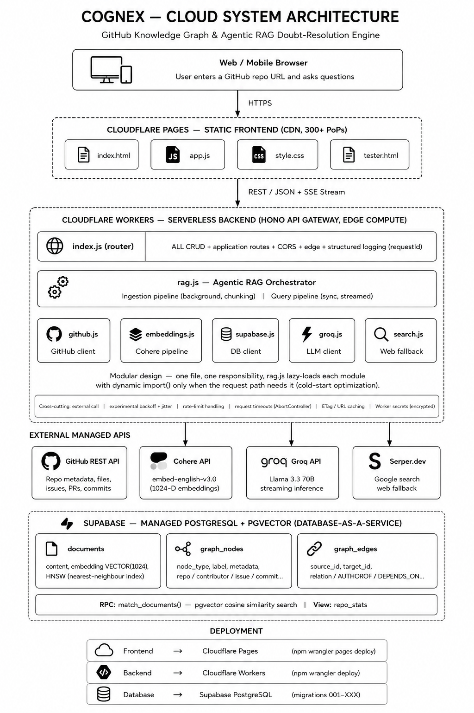
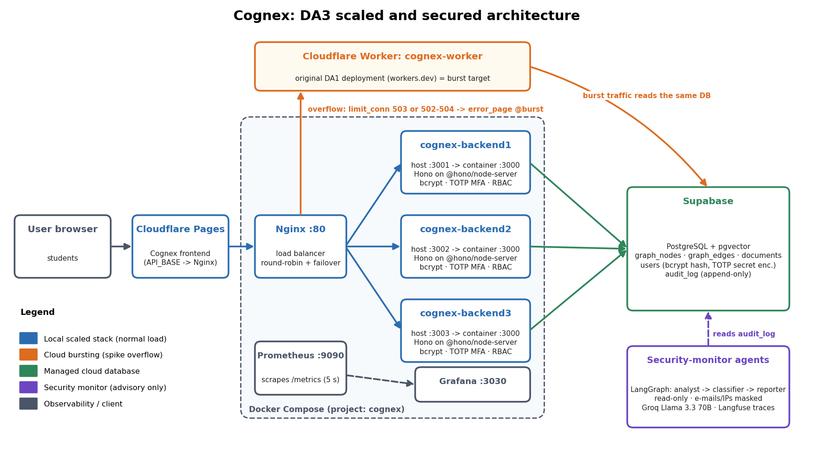

# 🧠 Cognex — Knowledge Graph & Doubt Resolution Engine

> Paste a GitHub URL, get a **knowledge graph** of the repository, and ask questions about it using **Agentic RAG**.

| | |
|---|---|
| **Live app (v1, Cloudflare)** | https://fa410d0a.cognex-5ij.pages.dev/ |
| **Repository** | https://github.com/ParthanahalliRehaan/3_Cognex |
| **Current version** | **2.0.0** (`v2` branch) · v1.2.0 lives on `main` |
| **Licence** | MIT |
| **Course** | BACSE344 – Cloud Infrastructure and Architecture (Digital Assignments 1 and 3) |

---

## Table of contents

1. [What is Cognex?](#1-what-is-cognex)
2. [v1 → v2 at a glance](#2-v1--v2-at-a-glance)
3. [Architecture](#3-architecture)
4. [Tech stack](#4-tech-stack)
5. [Database design](#5-database-design)
6. [API overview](#6-api-overview)
7. [v1 features (DA1): serverless on Cloudflare](#7-v1-features-da1-serverless-on-cloudflare)
8. [v2 features (DA3): scale](#8-v2-features-da3-scale)
9. [v2 features (DA3): security](#9-v2-features-da3-security)
10. [Observability and the security-monitor agents](#10-observability-and-the-security-monitor-agents)
11. [Project structure](#11-project-structure)
12. [Getting started](#12-getting-started)
13. [Testing](#13-testing)
14. [Branching and deployment](#14-branching-and-deployment)
15. [Known limitations](#15-known-limitations)
16. [Changelog](#16-changelog)
17. [Licence and author](#17-licence-and-author)

---

## 1. What is Cognex?

Developers and students lose hours understanding unfamiliar repositories: reading READMEs, browsing file trees, tracing dependencies. Cognex automates that:

1. **Ingest**: fetches repo metadata, files, commits, issues, PRs and contributors from the GitHub API.
2. **Graph**: builds a typed knowledge graph (nodes + edges) and stores it in PostgreSQL.
3. **Embed**: chunks text, embeds it (1024-D) and stores vectors in pgvector.
4. **Ask**: answers natural-language questions ("How does auth work?", "Who are the top contributors?") by combining vector search, graph retrieval and optional web search, then streams an LLM answer.

---

## 2. v1 → v2 at a glance

| Area | **v1** (DA1, `main`) | **v2** (DA3, `v2`) |
|---|---|---|
| Backend runtime | Cloudflare Worker (Hono) | **Same Hono app, plus a Node server (`server.js`) that runs it in Docker** |
| Instances | 1 (serverless, auto-scaled by Cloudflare) | **3 containers behind Nginx** (round-robin load balancer) |
| Peak-demand handling | Platform scaling only | Load balancing, passive **failover** (0 failed requests), **cloud-bursting** config to the Worker |
| Authentication | None | **bcrypt** passwords + mandatory **TOTP MFA** + JWT |
| Authorisation | None | **Role-based**: viewer / editor / admin; PUT and DELETE guarded (401 / 403) |
| Container security | n/a | **Trivy**-scanned, hardened image (Alpine, multi-stage, non-root) |
| Audit trail | None | Append-only `audit_log` (DB trigger blocks UPDATE / DELETE) |
| Observability | Worker logs | **Prometheus + Grafana** metrics, structured **pino** logs |
| AI security layer | n/a | **LangGraph multi-agent** security monitor (read-only, masked data, Langfuse traces) |
| Database | `documents`, `graph_nodes`, `graph_edges` | + `users`, `audit_log` (migration `004`) |
| Tests | Vitest (Worker) | + **22 security / agent tests**, 3 agent evals |

> **Important:** the deployed Cloudflare Worker is still the **v1, unauthenticated** app. v2's secured stack is the Node / Docker deployment. `src/index.js` is deliberately unmodified; v2 wraps it (`src/node/app.js`).

---

## 3. Architecture

### v1: serverless



| Layer | Technology | Cloud service | Purpose |
|---|---|---|---|
| Client | HTML5 / CSS3 / JS | Browser | UI |
| Frontend | Static site + Cytoscape.js | **Cloudflare Pages** | Graph visualisation, chat UI |
| Backend | Hono | **Cloudflare Workers** | REST API, RAG orchestration |
| Database | PostgreSQL + pgvector | **Supabase** | Graph + vector storage |
| Embeddings | `embed-english-v3.0` | **Cohere** | 1024-D vectors |
| LLM | Llama 3.3 70B | **Groq** | Streaming answers |
| Web search | Google Search API | **Serper.dev** | Fallback context |
| Data source | REST API | **GitHub** | Repo metadata |

**Ingestion:** `POST /api/ingest` → GitHub API → graph builder → Cohere embeddings → Supabase.
**Query:** `POST /api/ask` → embed query → pgvector search → graph retrieval → *(optional)* Serper → Groq → streamed response.

### v2: scaled and secured



```
Browser / curl / hey
        │
     NGINX :80              ← load balancer + failover (reverse proxy)
   ┌─────┼─────┐
backend1 backend2 backend3  ← identical Docker containers (3001 / 3002 / 3003 → 3000 inside)
   └─────┼─────┘
     SUPABASE (cloud Postgres)   ← one shared database

Prometheus ──scrapes /metrics──▶ backends ──▶ Grafana (:3030)
audit_log (Supabase) ──▶ security-monitor agents ──▶ incident report (+ Langfuse trace)
overflow / total outage ──(nginx.burst.conf)──▶ Cloudflare Worker   ← cloud bursting
```

---

## 4. Tech stack

| Layer | Technology |
|---|---|
| Frontend | Vanilla HTML / CSS / JS, Cytoscape.js |
| Backend | Node.js 22, Hono, `@hono/node-server`, Cloudflare Workers |
| Database | PostgreSQL 15, pgvector, Supabase |
| AI / ML | Cohere (embeddings), Groq Llama 3.3 70B (LLM), Vercel AI SDK |
| Search / data | Serper.dev, GitHub REST API |
| **Scale (v2)** | Docker Compose, Nginx 1.27, `hey` load tester |
| **Security (v2)** | bcryptjs, otplib (TOTP), Hono JWT, AES-256-GCM, Trivy |
| **Observability (v2)** | pino, prom-client, Prometheus, Grafana, Langfuse |
| **Agents (v2)** | LangGraph, LangChain Groq |
| Testing | Vitest, `@cloudflare/vitest-plugin` |

---

## 5. Database design

Supabase PostgreSQL with the `pgvector` extension. Run migrations in order from `supabase/migrations/`.

| Table | Since | Purpose | Key columns |
|---|---|---|---|
| `documents` | v1 | Text chunks for vector search | `repo_url`, `content`, `metadata JSONB`, `embedding VECTOR(1024)` |
| `graph_nodes` | v1 | Graph entities | `repo_url`, `node_type`, `label`, `metadata` |
| `graph_edges` | v1 | Graph relationships | `source_node_id`, `target_node_id`, `relation`, `metadata` |
| `users` | **v2** | Accounts | `email` (unique), `password_hash` (`$2b$10$…`), `role`, `totp_secret` (AES-256-GCM), `mfa_enabled` |
| `audit_log` | **v2** | Security events | `ts`, `event`, `actor_email`, `actor_role`, `ip`, `method`, `path`, `status`, `details` |

- **Node types:** `file`, `function`, `contributor`, `issue`, `pr`, `commit`, `dependency`, `repo`, `readme`
- **Edge relations:** `CONTAINS`, `AUTHORED`, `MODIFIES`, `REFERENCES`, `FIXES`, `DEPENDS_ON`, `IMPORTS`, `OPENED`
- **Indexes:** B-tree, GIN (JSONB) and an **HNSW** index on `embedding` for cosine similarity.
- **RPC:** `match_documents(query_embedding, match_threshold, match_count, filter_repo_url)`; **view:** `repo_stats`.

| Migration | Contents |
|---|---|
| `001_init.sql` | Tables, pgvector, `match_documents()` |
| `002_migration.sql` | Edge metadata + indexes |
| `003_Bridge-Migration.sql` | HNSW index, performance indexes, `repo_stats` view |
| `004_auth_audit.sql` | **v2:** `users`, `audit_log`, RLS (on, no policies), append-only trigger. Safe to re-run |

`users` and `audit_log` have Row Level Security enabled with **no policies**, so the public anon key can read nothing; only the backend's service key can. `audit_log` has a trigger that raises an exception on UPDATE / DELETE.

---

## 6. API overview

Full reference: [`API_DOCUMENTATION.md`](API_DOCUMENTATION.md).

### CRUD (nodes, edges, documents)

| Resource | Create | List | Read | Update | Delete |
|---|---|---|---|---|---|
| Nodes | `POST /api/nodes` | `GET /api/nodes?repoUrl=` | `GET /api/nodes/:id` | `PUT` 🔒 | `DELETE` 🔒 |
| Edges | `POST /api/edges` | `GET /api/edges?repoUrl=` | `GET /api/edges/:id` | `PUT` 🔒 | `DELETE` 🔒 |
| Documents | `POST /api/documents` | `GET /api/documents?repoUrl=` | `GET /api/documents/:id` | `PUT` 🔒 | `DELETE` 🔒 |

🔒 = guarded **in v2 (Node/Docker stack only)**. In v1 these were open.

### Application routes

| Endpoint | Method | Description |
|---|---|---|
| `/health` | GET | Service + dependency status |
| `/api/ingest` | POST | Start repository ingestion (background) |
| `/api/ask` | POST | Ask a question → streaming answer |
| `/api/graph` | GET | Full knowledge graph (**the hottest endpoint under load**) |
| `/api/status` | GET | Ingestion progress |
| `/api/stats` | GET | Repository analytics |
| `/metrics` | GET | **v2:** Prometheus metrics (blocked at Nginx, scraped directly) |

### Auth routes (v2)

| Endpoint | Purpose |
|---|---|
| `POST /api/auth/register` | Creates a user with a bcrypt hash and role `viewer` (a client-chosen role is ignored) |
| `POST /api/auth/login` | Checks password, returns a 5-minute **pre-auth** token (useless on the real API) |
| `POST /api/auth/mfa/setup` | First time only: returns a TOTP QR code |
| `POST /api/auth/mfa/verify` | Checks the 6-digit code, returns the 1-hour **access token** carrying the role |
| `GET /api/auth/me` | Current user |

---

## 7. v1 features (DA1): serverless on Cloudflare

- **Serverless backend**: Hono on Cloudflare Workers; `ctx.waitUntil()` runs ingestion in the background.
- **Static frontend** on Cloudflare Pages with Cytoscape.js graph view, tabs and streaming chat.
- **Agentic RAG**: vector search + graph traversal + optional web search, with a Groq model fallback chain and token-budget trimming.
- **Resilience**: exponential backoff with jitter on all external APIs, ETag caching for GitHub, LRU embedding cache, in-flight request de-duplication.
- **Secrets** stored as Cloudflare Worker secrets (encrypted, runtime-only).

---

## 8. v2 features (DA3): scale

**Peak-demand scenario.** Just before a course deadline, hundreds of students open the same repository's graph within minutes. The hardest-hit API is `GET /api/graph?repoUrl=…` (two parallel Supabase reads per call, identical across users, called on every page load). Details: [`docs/q1-peak-demand.md`](docs/q1-peak-demand.md).

### Three backends behind Nginx

`docker-compose.yml` runs `backend1/2/3` (same image, different `INSTANCE_ID`), `nginx`, `prometheus` and `grafana`. Each response carries an `X-Instance-ID` header, so distribution across instances is visible. Healthchecks hit `/health` every 10 s and Nginx waits for all three to be healthy.

| Nginx config | Purpose |
|---|---|
| `nginx.1.conf` | One backend (baseline for "1 vs 3") |
| `nginx.3.conf` | Plain round-robin (failover **before**) |
| `nginx.3.failover.conf` | `max_fails=1 fail_timeout=10s`, 1 s connect timeout, `proxy_next_upstream … tries 3` (failover **after**, default) |
| `nginx.burst.conf` | Cloud bursting: `limit_conn` caps local concurrency; overflow / outage (502/503/504) is replayed to the Cloudflare Worker (`X-Served-By: cloud-burst`) |

### Results

Same tool (`hey`), 1,000 requests, concurrency 50, three runs each.

| Metric | 1 instance (mean of 3) | 3 instances (mean of 3) | Change |
|---|---|---|---|
| Requests / second | 148.5 | 180.1 | **+21.3 %** |
| Average response time | 0.320 s | 0.258 s | **−19.3 %** |
| Failed requests | 0 | 0 | none |

| Failover (backend2 stopped 3 s into the run) | Failed requests | Requests/sec |
|---|---|---|
| Before (plain round-robin, `nginx.3.conf`) | **2** of 1000 | 68.4 |
| After (`nginx.3.failover.conf`) | **0** of 1000 | 90.1 |

Raw output: `perf/results/`. Runner: `node perf/run.mjs load | failover before | failover after | summarize`.

> The gain is modest because the bottleneck is the shared Supabase database and everything runs on one machine. Scaling backends helps most when the backend, not the database, is the constraint.

### Why cloud bursting

The rush is short and spiky. Sizing local containers for a normal day and sending only the overflow to the already-deployed Cloudflare Worker means paying for burst capacity only while the spike lasts, while reusing a deployment that already exists.

---

## 9. v2 features (DA3): security

**Most sensitive data:** user e-mails, password hashes and TOTP secrets (`users`), plus GitHub contributor identities in `graph_nodes`.

| Control | Implementation |
|---|---|
| **Password storage** | bcrypt, cost 10, salted (`$2b$10$…`); before/after DB evidence in `supabase/q2a_before_demo.sql` and the report |
| **MFA** | Mandatory TOTP (Google / Microsoft Authenticator). No access token exists without a valid code |
| **TOTP secrets at rest** | AES-256-GCM (`TOTP_ENC_KEY`) in `src/node/crypto.js` |
| **Authorisation** | `requireAuth` → **401** (no valid token); `requireRole` → **403** (wrong role) |
| **Roles** | `viewer` read-only · `editor` may PUT · `admin` may PUT and DELETE. Promotion only via `npm run set-role` (self-registration cannot elevate) |
| **Brute-force lockout** | 5 failures / 15 min per e-mail / IP → **429**, counted in the shared `audit_log` so it holds across all 3 instances |
| **Audit log** | Every login, MFA failure, rejected request and mutation; append-only via DB trigger |
| **Fail-fast config** | Server refuses to start without `JWT_SECRET` and `TOTP_ENC_KEY` |

### Container hardening (Trivy)

| | Before (`Dockerfile.before`) | After (`Dockerfile`) |
|---|---|---|
| Base image | `node:20` (Debian 12) | `node:22-alpine`, multi-stage |
| User | root | non-root (`node`) |
| Contents | dev dependencies + whole folder | production deps + `server.js` + `src/` only |
| **CRITICAL** | **82** | **0** |
| **HIGH** | **1,547** | **11** |

Reproduce: `node scripts/trivy.mjs <image> before|after` then `node scripts/trivy.mjs table`.

### Threat model (GDPR applies; no health data, so HIPAA does not)

| Threat agent | Controls | GDPR requirement |
|---|---|---|
| **Brute-force attacker** (external) | bcrypt, mandatory MFA, lockout, monitor agent | **Art. 32(1)**: appropriate technical measures to ensure confidentiality of processing |
| **Malicious insider** (authenticated) | Role-based PUT / DELETE, append-only audit log, monitor agent | **Art. 32(4)**: staff with access process data only on instructions (supports Art. 5(1)(f)) |

Full table: [`docs/q2-threat-model.md`](docs/q2-threat-model.md).

---

## 10. Observability and the security-monitor agents

| Signal | Tooling |
|---|---|
| **Logs** | pino JSON logs (`docker logs cognex-backend1`) |
| **Metrics** | `prom-client` → Prometheus (scrapes every 5 s) → Grafana dashboard: requests/s per instance, p95 latency, 5xx errors, auth rejections (401/403/429), instances up |
| **Traces** | Langfuse traces of agent runs (optional) |

**Security-monitor agents** (`backend/cognex-worker/agents/`, LangGraph):

```
START → analyst ──(findings?)──▶ classifier → reporter → END
              └──(none)────────────────────────▶ reporter
```

- **analyst** proposes suspicious patterns from a per-actor summary of `audit_log`
- **classifier** maps each to a threat actor (brute-force attacker / malicious insider) and severity
- **reporter** writes the incident summary

Guardrails: **read-only** (agents receive rows, never DB access), **masked** (e-mails and IPs pseudonymised before anything reaches Groq), **validated** (invented actors or labels are dropped), **fallback** to deterministic rules if there is no key or the model fails. Three eval fixtures (brute force, insider mass-delete, normal traffic) are scored by `npm run agents:eval`.

---

## 11. Project structure

```
3_Cognex/
├── frontend/                     # Cloudflare Pages site (index.html, app.js, style.css, tester.html)
├── backend/cognex-worker/
│   ├── src/
│   │   ├── index.js              # Hono app: ALL v1 routes (Cloudflare Worker entry, unmodified in v2)
│   │   ├── github.js graph.js embeddings.js supabase.js rag.js groq.js search.js
│   │   └── node/                 # v2: secured Node wrapper
│   │       ├── app.js            # wraps index.js, guards PUT/DELETE
│   │       ├── auth.js crypto.js middleware.js store.js audit.js
│   ├── server.js                 # v2: Node entry (X-Instance-ID, /metrics, pino, graceful shutdown)
│   ├── agents/                   # v2: LangGraph security monitor + evals
│   ├── scripts/                  # set-role.mjs, mfa-cli.mjs
│   ├── test/                     # v1 unit tests + test/node (22 security/agent tests)
│   ├── Dockerfile                # hardened ("after")
│   ├── Dockerfile.before         # deliberately unhardened ("before")
│   └── wrangler.jsonc            # Cloudflare Worker config (v1)
├── nginx/                        # 4 configs (1 / 3 / failover / burst)
├── prometheus/  grafana/         # metrics + dashboards
├── perf/                         # load-test runner + results
├── scripts/                      # demo-auth.mjs, trivy.mjs, make_diagram.py
├── supabase/migrations/          # 001 → 004, plus q2a_before_demo.sql
├── docs/                         # q1-peak-demand, q2-threat-model, diagrams, evidence
├── docker-compose.yml
├── API_DOCUMENTATION.md
└── LICENSE.md
```

---

## 12. Getting started

### A. v1: deploy on Cloudflare

```bash
# 1. Database: run supabase/migrations/001 → 003 in the Supabase SQL editor
# 2. Backend
cd backend/cognex-worker && npm install
npx wrangler secret put SUPABASE_URL          # also: SUPABASE_SERVICE_KEY, SUPABASE_ANON_KEY,
                                              #       GROQ_API_KEY, GITHUB_TOKEN, COHERE_API_KEY, WEB_SEARCH_API_KEY
npm run deploy
# 3. Frontend (point API_BASE in frontend/app.js at your Worker URL first)
cd ../../frontend && npx wrangler pages deploy .
```

### B. v2: run the scaled, secured stack locally

**Prerequisites:** Docker Desktop, Node 20.6+, an Authenticator app.

```bash
# 1. Database: also run supabase/migrations/004_auth_audit.sql

# 2. Configure secrets. Create backend/cognex-worker/.env (git-ignored; never commit it):
#    SUPABASE_URL, SUPABASE_SERVICE_KEY, SUPABASE_ANON_KEY,
#    JWT_SECRET, TOTP_ENC_KEY            (required: generate each with the command below)
#    GROQ_API_KEY, GITHUB_TOKEN, COHERE_API_KEY, WEB_SEARCH_API_KEY   (for ingest / ask)
#    LOGIN_MAX_FAILS, LOGIN_WINDOW_MIN   (lockout tuning)
#    LANGFUSE_PUBLIC_KEY, LANGFUSE_SECRET_KEY, LANGFUSE_BASE_URL      (optional tracing)
node -e "console.log(require('crypto').randomBytes(32).toString('hex'))"

# 3. Start everything
docker compose up -d --build
docker ps                                   # wait for 3 × (healthy)
```

| Service | URL |
|---|---|
| App via Nginx | http://localhost |
| Backends (direct) | http://localhost:3001 · :3002 · :3003 |
| Prometheus | http://localhost:9090 |
| Grafana | http://localhost:3030 (change the default credentials) |

**Prove distribution**

```bash
curl -s -o /dev/null -D - "http://localhost/api/graph?repoUrl=<REPO_URL>" | grep -i x-instance-id
```

**Switch Nginx config** (default is failover): `NGINX_CONF=nginx.burst.conf docker compose up -d --force-recreate nginx`

**Load test and failover**

```bash
REPO_URL=<repo> node perf/run.mjs load
REPO_URL=<repo> node perf/run.mjs failover before
REPO_URL=<repo> node perf/run.mjs failover after
node perf/run.mjs summarize
```

**Auth demo** (registers, logs in, saves a QR to `docs/evidence/q2/`, then shows the 401 / 403 / success paths)

```bash
EMAIL=you@example.com PASSWORD='choose-a-strong-one' node scripts/demo-auth.mjs
cd backend/cognex-worker && npm run set-role -- you@example.com admin
```

**Trivy before / after**

```bash
BACKEND_DOCKERFILE=Dockerfile.before BACKEND_TAG=before docker compose build backend1
node scripts/trivy.mjs cognex-backend:before before
docker compose build backend1
node scripts/trivy.mjs cognex-backend:hardened after
node scripts/trivy.mjs table
```

**Security-monitor agents**

```bash
cd backend/cognex-worker
npm run agents:run -- --fixture brute_force     # fake attack data
npm run agents:run -- --window-min 60           # real audit_log, last hour
```

---

## 13. Testing

```bash
cd backend/cognex-worker
npm test                  # v1: Worker tests (Vitest)
npm run test:security     # v2: 22 tests (auth, MFA, roles, crypto, agents, masking)
npm run agents:eval       # v2: 3 agent evals (brute force, insider, normal traffic)
```

Quick API checks against any running instance:

```bash
curl <BASE_URL>/health
curl -X POST <BASE_URL>/api/ask -H "Content-Type: application/json" \
  -d '{"repoUrl":"https://github.com/owner/repo","query":"How does auth work?"}'
curl -i -X DELETE <BASE_URL>/api/nodes/<UUID>        # v2 stack without a token → 401
```

---

## 14. Branching and deployment

| Branch | Contents | Deploys to |
|---|---|---|
| `main` | **v1**: Cloudflare Worker + Pages | Production (Cloudflare Git integration) |
| `v2` | **v2**: v1 + Docker / Nginx / security / observability | Not deployed; runs locally via Docker Compose |

Cloudflare is connected to this repository, so anything merged into the production branch can trigger a redeploy. Before merging v2 into `main`:

- `frontend/app.js` must keep the hostname-based `API_BASE` (localhost for dev, the Worker URL otherwise).
- Never commit `.env*`; secrets live in Cloudflare (Worker secrets) or the local git-ignored `.env`.
- `src/index.js` and `wrangler.jsonc` are unchanged in v2, and `src/node/` is never imported by the Worker entry, so the Worker bundle is unaffected.

---

## 15. Known limitations

- The **Cloudflare deployment is v1** and has no authentication; the secured stack is Node / Docker.
- Reads (`GET`) and create (`POST`) endpoints are public by design; only update and delete are role-restricted.
- TOTP codes are not tracked against replay within their validity window.
- Load-test gains are bounded by the shared Supabase database and a single host.
- Grafana ships with default credentials; change them for anything beyond local use.
- GDPR mapping is for coursework, not legal advice.

---

## 16. Changelog

| Version | Date | Highlights |
|---|---|---|
| **2.0.0** | Oct 2026 | Dockerised Node entry, 3 backends + Nginx, failover and cloud-burst configs, bcrypt + TOTP MFA + RBAC, audit log, Trivy-hardened image, Prometheus / Grafana, LangGraph security agents, 22 security tests |
| **1.2.0** | Aug 2026 | Groq model fallback fix, README + API docs + architecture diagram |
| **1.0.0** | Jul 2026 | Cloudflare Worker + Pages, Supabase pgvector, Cohere embeddings, Groq streaming RAG, full CRUD API |

---

## 17. Licence and author

MIT: see [LICENSE.md](LICENSE.md).

**Rehaan Parthanahalli** · GitHub [@ParthanahalliRehaan](https://github.com/ParthanahalliRehaan)